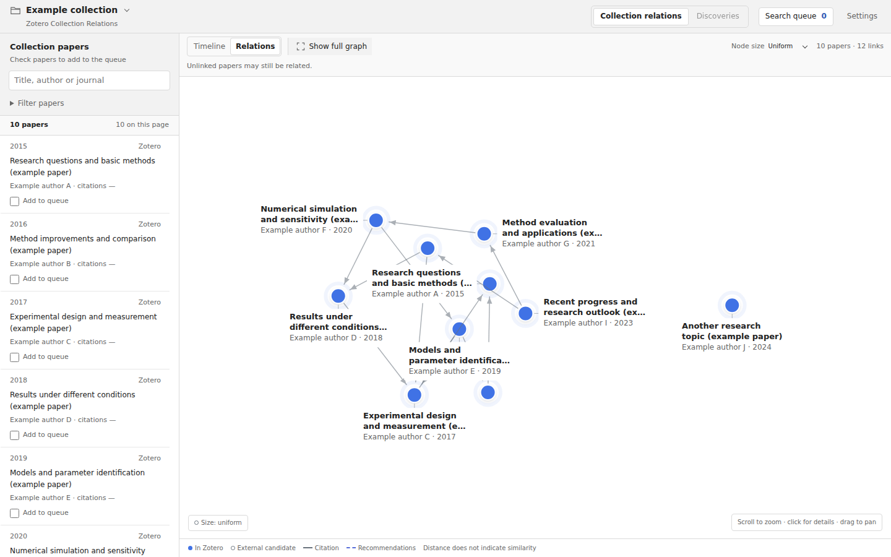
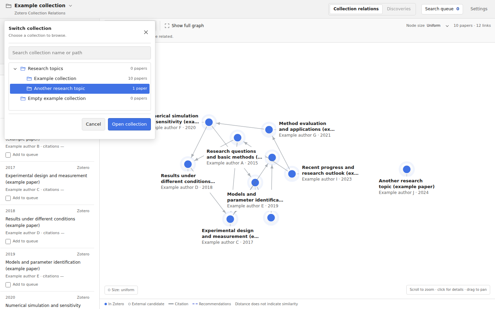
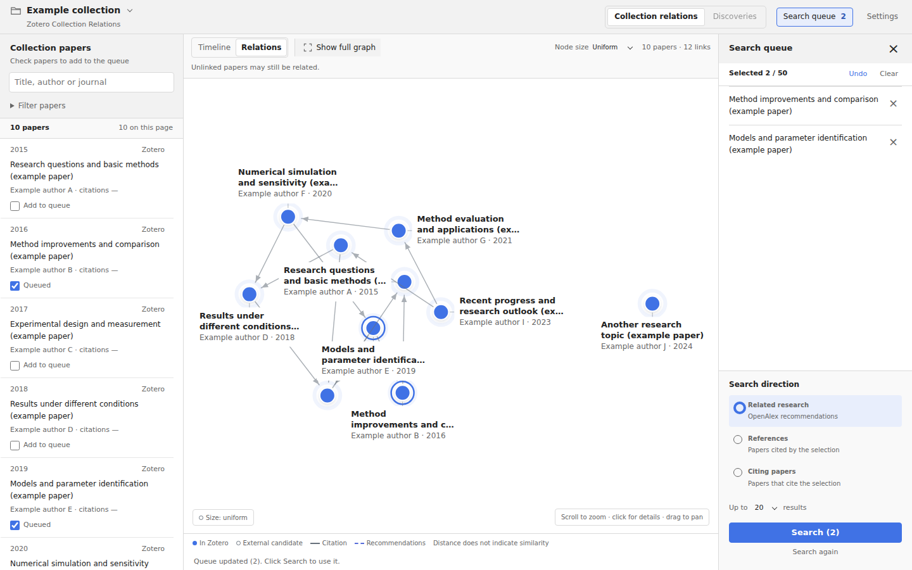
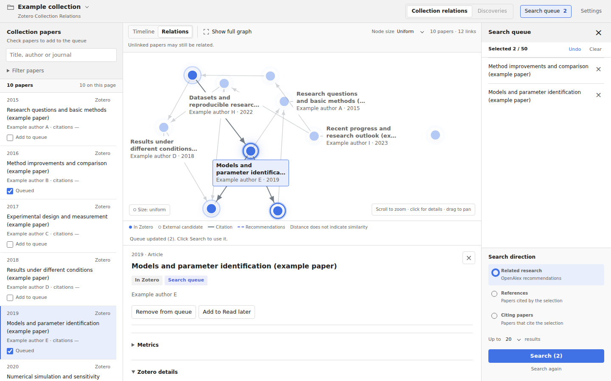

# Zotero Collection Relations

**English** | [简体中文](README.zh-CN.md)

**See how papers connect. Find what to read next.**

Zotero Collection Relations displays papers and available citation relationships from your Zotero collections in an interactive graph. Browse your library, choose several papers as starting points, and explore references, citing papers and related research.

Use it to map a research topic, prepare a literature review, or continue exploring from papers you have read.

*The paper list and graph appear together. All screenshots use fictional papers and example links.*

- **Explore connections:** switch between the graph and timeline, and follow citation directions.
- **Choose starting papers:** add papers to an editable search queue before starting a search.
- **Read papers:** view details, locate Zotero items and open available local PDFs.
- **Continue exploring:** move through previous results and restore locally saved sessions.

## Installation

**Requires Zotero 9.x.** The current version is **0.8.7, a development build**. Collection browsing, switching and interface languages have been tested on Windows. Live online discovery and other platforms still need testing.

1. Get the `.xpi` package from the developer. Published packages will be available in this repository's **Releases** section.
2. In Zotero, open **Tools → Plugins**.
3. Drag the `.xpi` into the Plugins window, or use the gear menu to choose **Install Plugin From File**. Follow the installation prompt.
4. Select a collection in Zotero's left pane and click **Relations** above the collection tree. You can also use **Tools → Zotero Collection Relations…**.

See the [Zotero plugin installation guide](https://www.zotero.org/support/plugins). Online matching and discovery require access to OpenAlex.

## Usage

### Browse a collection

The paper list is on the left and the relations graph is in the center. Search by title, author or journal, or switch to **Timeline** to browse by year.

Click the **collection name in the upper left** to switch collections. Expand or collapse parent collections, then double-click a name or select **Open collection**. Search results retain their parent paths. Each collection keeps its own queue and exploration history.

*Switching loads another collection. **Filter papers → Collection** filters the current results.*

Node labels show titles, authors and years. Zoomed-out views prioritize author and year; zooming in reveals two-line titles. Hover to preview a paper, or click a node or list title to open its details.

| Action | Result |
| --- | --- |
| Scroll | Zoom the graph |
| Drag the canvas | Pan the view |
| Ctrl + scroll | Cycle overlapping papers under the pointer |
| Hover / click | Preview / open details |
| Show full graph | Return to the overview |

Citation arrows point toward the cited paper. Dashed links indicate recommendations. Distance is not a similarity score.

### Choose papers and search

1. Check papers in the list, or choose **Add to queue** in their details.
2. Open **Search queue** in the upper right to review your starting papers. Remove individual entries, clear the queue or undo a change.
3. Choose a search direction and result limit, then click **Search**.
4. Browse candidates in **Discoveries**, add useful papers to the queue, and continue exploring.

*Two papers are queued. The right panel shows the starting papers and search direction.*

| Direction | What it finds |
| --- | --- |
| Related research | Papers recommended by OpenAlex |
| References | Papers cited by the selection |
| Citing papers | Papers that cite the selection |

**Clicking a paper opens its details; checking it adds it to the queue.** Queue edits and direction changes do not start a search. A queue holds up to 50 papers; each search can return up to 10, 20 or 40 results.

### View details and read

Click a paper to see its title, authors, year and source. For items already in Zotero, use **Locate item**. When a local PDF is available, use **Read PDF**. Choose **Add to Read later** to keep a reading plan.

*Details and the search queue can stay open together.*

## Settings and data

Open **Settings** in the upper right to choose **Follow Zotero / 简体中文 / English**, set your OpenAlex API key, or adjust the default result limit, node size and automatic citation updates.

Saving a language change updates open windows while keeping the current collection, filters, queue and selected paper. **It changes the plugin's interface only.** Your titles, authors, abstracts, notes, attachment names and collection names stay in their original language; they are not translated or rewritten.

Matching, citation records and recommendations come from **OpenAlex**. Basic queries support anonymous access. For regular use, you can get a free API key to increase your allowance. See [OpenAlex authentication and limits](https://help.openalex.org/api/authentication/).

Matching sends a paper's DOI or title; relationship queries use work IDs. PDF contents, Zotero notes and collection names are not uploaded. The key is stored locally in Zotero preferences without encryption and can be explicitly cleared.

## FAQ

**Why do some papers have no links?**

Missing matches, incomplete citation records, filters and pagination can hide links. Unlinked papers may still be related. The graph shows a collection's direct items; it does not automatically merge subcollections. Large collections show up to 160 papers per page, with links across pages omitted.

**Does Related research mean a direct citation?**

It shows OpenAlex recommendations. Use **References** or **Citing papers** for explicit citation directions.

**Does the plugin change my Zotero library?**

Queues, reading plans and exploration history are saved in local plugin sessions. This build does not create or modify bibliographic items, attachments, notes, tags, collections or Zotero Related relationships.

## Feedback and development

Include the plugin version, Zotero version, operating system and reproduction steps when reporting an issue. Hide personal information and keys in screenshots.

[Contributing](CONTRIBUTING.md) · [Architecture](docs/04_ARCHITECTURE.md) · [Publishing](docs/PUBLISHING.md) — development documents are currently in Chinese.

This is an independent third-party plugin.
