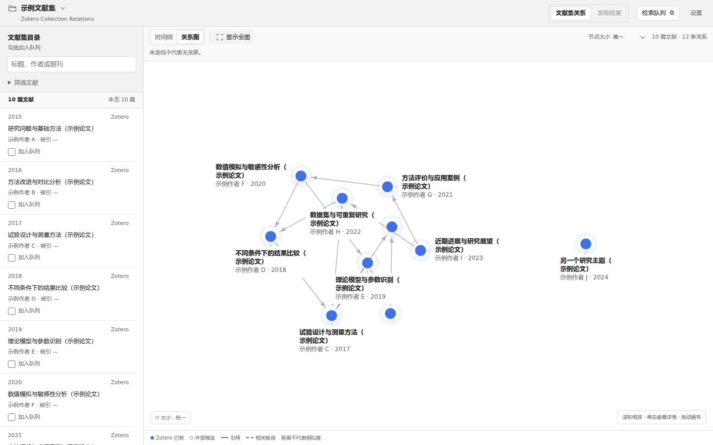
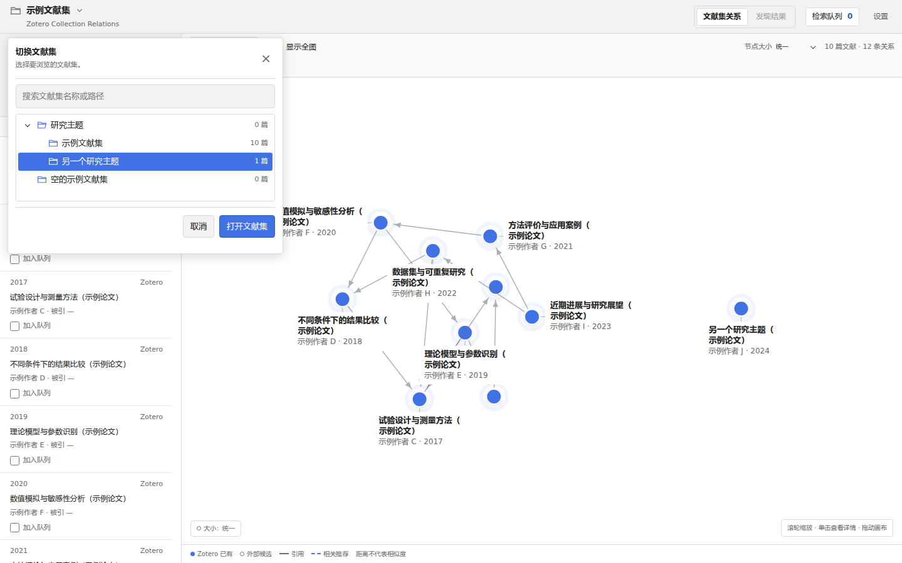
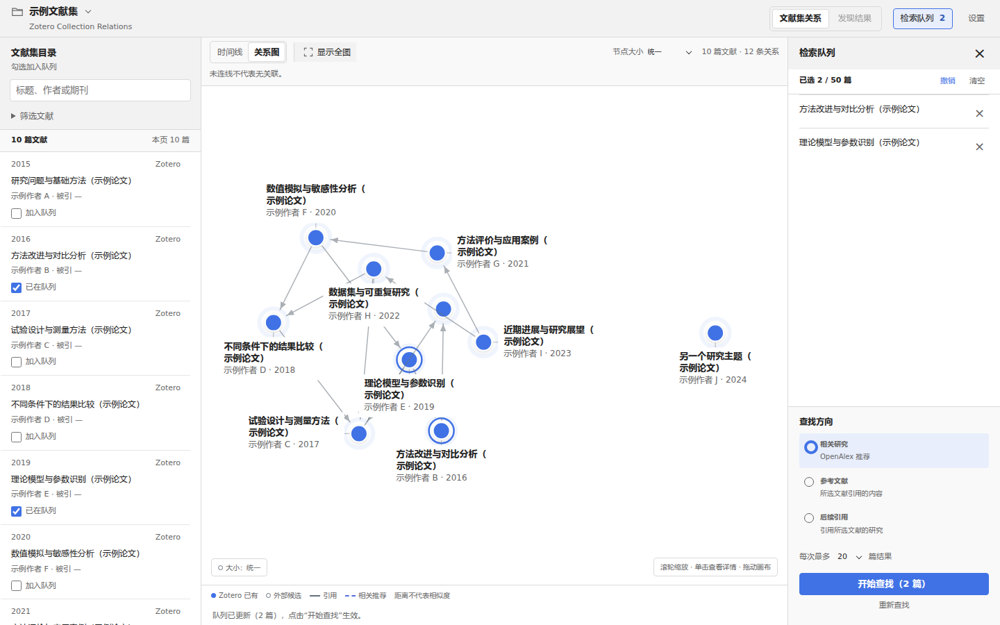
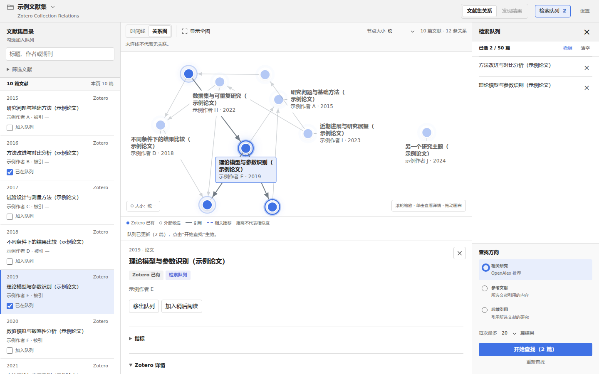

# Zotero Collection Relations

[English](README.md) | **简体中文**

**从文献集出发，看清文献联系，找到下一篇值得读的论文。**

Zotero Collection Relations 将 Zotero 文献集中的论文与可用引用关系呈现在交互图谱中，帮助使用者直观梳理研究脉络。插件支持父子文献集切换、文献详情与本地 PDF 阅读，并通过可编辑的检索队列，以多篇论文为起点查找参考文献、后续引用和相关研究。

适合梳理一个研究主题、准备文献综述，或从已读论文继续探索。

*文献目录与关系图同时呈现；以下截图均使用虚构论文和示例连线。*

- **看清联系**：在关系图与时间线之间切换，查看论文之间的引用方向。
- **选择起点**：把感兴趣的论文加入可编辑的检索队列，再明确发起查找。
- **阅读论文**：查看详情、定位 Zotero 条目，打开已有的本地 PDF。
- **继续探索**：在历史结果间切换，恢复保存在本机的探索会话。

## 安装

**要求：Zotero 9.x。** 当前版本为 **0.8.7 开发版**。Windows 已验证文献集浏览、切换及中英文设置；真实在线查找及其他平台仍待实测。

1. 获取 `.xpi` 安装包。当前可使用开发者提供的构建；正式发布后，安装包将放在仓库的 **Releases** 页面。
2. 打开 Zotero，进入 **工具 → 插件（Tools → Plugins）**。
3. 将 `.xpi` 拖入插件窗口，按提示完成安装。也可通过齿轮菜单选择“从文件安装插件”。
4. 回到 Zotero，在左侧选中一个文献集，点击文献集上方的 **关系图（Relations）**。也可通过 **工具 → Zotero Collection Relations…** 打开。

安装方式可参考 [Zotero 官方说明](https://www.zotero.org/support/plugins)。日常使用只需 Zotero 和安装包；联网查询需要访问 OpenAlex。

## 使用

### 浏览文献集

打开插件后，左侧是文献目录，中央是关系图。可以按标题、作者或期刊筛选，也可以切到 **时间线** 按年份浏览。

点击**左上角的文献集名称**即可切换。目录树支持展开、折叠父子文献集；选中后点击 **打开文献集**，或直接双击名称。搜索时会显示匹配文献集及其父路径。各文献集的检索队列和探索记录分别保留，切回来可以继续。

*“切换文献集”载入新的范围；“筛选文献 → 所属文献集”只筛选当前结果。*

节点旁显示标题、作者和年份。缩小时优先保留作者年份，放大后显示双行标题；悬停可预览完整信息，点击节点或左侧标题可打开详情。

| 操作 | 作用 |
| --- | --- |
| 滚轮 | 缩放图谱 |
| 拖动画布 | 移动视野 |
| Ctrl＋滚轮 | 切换光标处的重叠文献 |
| 悬停 / 单击 | 预览 / 打开详情 |
| 显示全图 | 回到整体视野 |

引用箭头指向被引用的论文；虚线表示相关推荐。图上的距离不代表相似度分数。

### 选择论文，继续查找

1. 勾选左侧文献，将它们加入 **检索队列**；也可在详情中点击 **加入队列**。
2. 点击右上角 **检索队列** 查看起点。可以逐篇移除、清空，或撤销上次修改。
3. 选择查找方向和结果数量，点击 **开始查找**。
4. 在 **发现结果** 中浏览候选，把新的论文加入队列，再继续下一次查找。

*图中两篇论文已加入队列，右侧可确认起点和查找方向。*

| 查找方向 | 找到什么 |
| --- | --- |
| 相关研究 | OpenAlex 推荐的相关论文 |
| 参考文献 | 所选论文引用的研究 |
| 后续引用 | 引用所选论文的后续研究 |

**点击文献是查看详情，勾选文献才是加入队列。** 修改队列或切换方向不会自动检索。队列最多 50 篇，每次可选择返回 10、20 或 40 篇结果。

### 查看详情与阅读

点击文献后，可查看标题、作者、年份和来源。对已有 Zotero 条目，可定位条目；有本地 PDF 时可点击 **阅读 PDF**。也可使用 **加入稍后阅读** 保留阅读计划。

*详情与检索队列可以同时打开，浏览文献时仍能确认本次检索起点。*

## 设置与数据来源

点击右上角 **设置**，可以选择 **跟随 Zotero / 简体中文 / English**，并配置 OpenAlex API Key、默认结果数、节点大小和自动更新被引量。语言保存后立即应用到已打开的工作台，保留文献集、筛选、队列和选中文献；这只切换插件界面文字，条目标题、作者、摘要、笔记、附件名称及文献集名称保留原文，不会自动翻译或改写 Zotero 数据。

文献匹配、引用记录和相关推荐均由 **OpenAlex** 提供。基础访问可匿名使用；经常查询时，可以注册并填写自己的免费 API Key 提高访问额度。具体规则见 [OpenAlex 官方说明](https://help.openalex.org/api/authentication/)。

联网匹配会发送文献的 DOI 或标题，关系查询使用作品 ID；PDF 正文、Zotero 笔记和文献集名称不会上传。Key 保存在本机偏好中，不加密，设置页支持显式清除。

## 常见问题

**为什么有些论文没有连线？**

尚未匹配、引用记录缺失、筛选或分页都可能造成缺线。没有连线不代表论文之间没有关系。当前按文献集的直接条目显示，不自动合并子集合；大集合每页最多 160 篇，跨页关系暂不显示。

**“相关研究”是否表示直接引用？**

它表示 OpenAlex 的推荐结果。要明确查看引用方向，请选择“参考文献”或“后续引用”。

**会修改我的 Zotero 文献吗？**

队列、阅读计划和探索历史保存在插件本地会话中。当前插件不创建或修改书目、附件、笔记、标签、文献集或 Zotero Related 关系。

## 反馈与开发

反馈时请附上插件版本、Zotero 版本、操作系统和复现步骤。截图请隐去个人信息和密钥。

[开发说明](CONTRIBUTING.md) · [代码结构](docs/04_ARCHITECTURE.md) · [发布准备](docs/PUBLISHING.md)

本项目为独立第三方插件。
